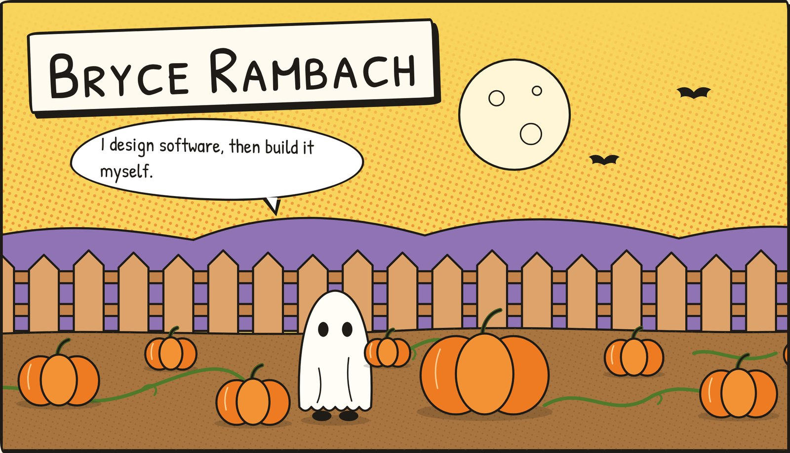
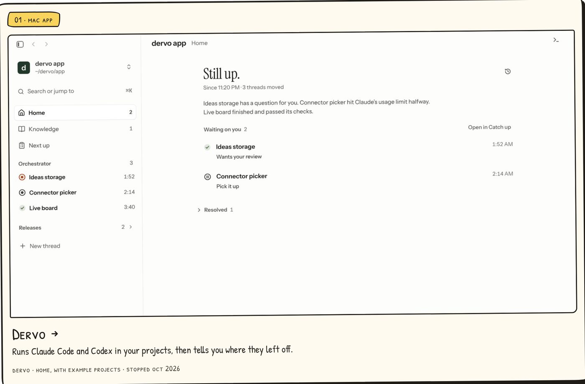
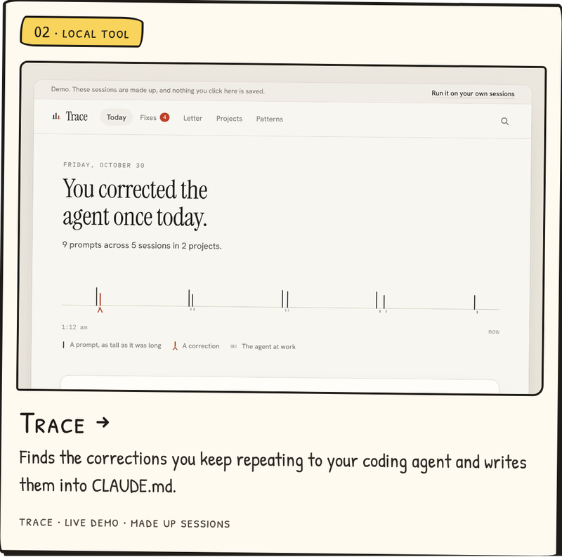
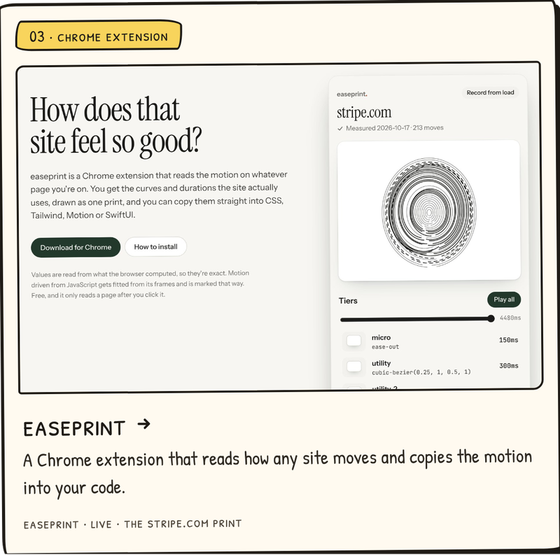
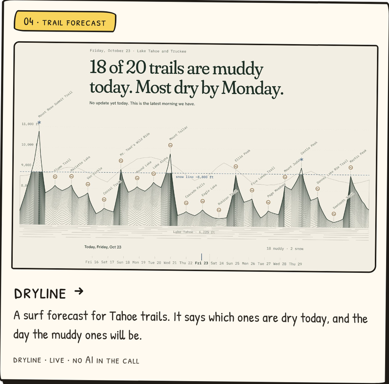
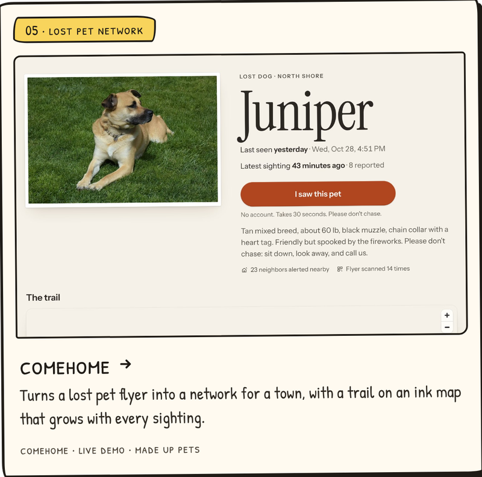
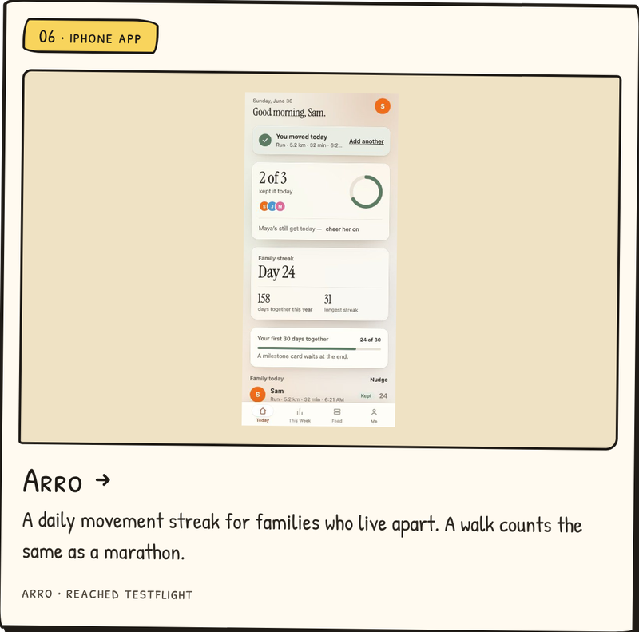
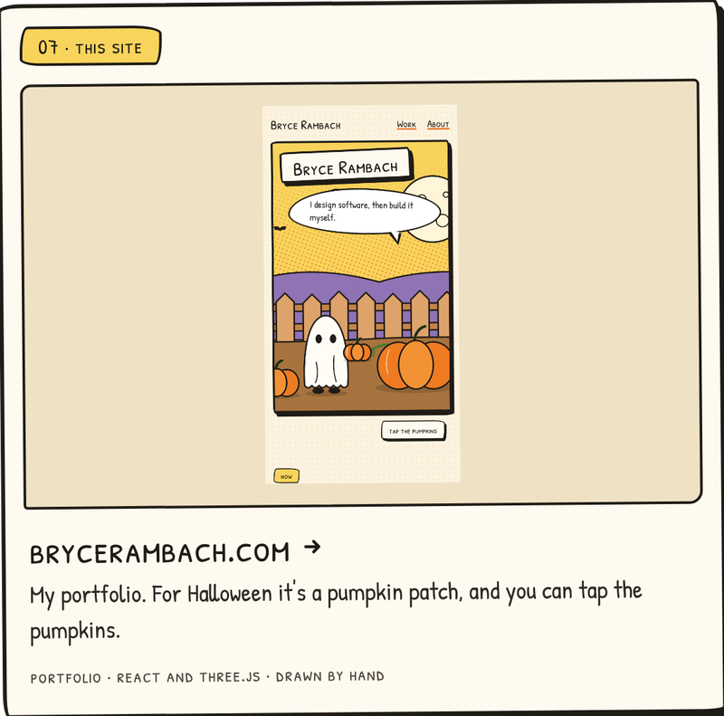

Hey, I'm Bryce. I build tools for AI agents and care a lot about how software feels. I finished a CS degree in May, and I'm looking for a founding or product engineer role at an early AI startup. Open to moving.

My [site](https://brycerambach.com) is a pumpkin patch until Halloween is over, so this page is too.

### Selected work

  
  

  
  

  
  

| | What it is | Try it | Source |
| --- | --- | --- | --- |
| **Dervo** | Mac app for running Claude Code and Codex side by side. Stopped in October 2026. | [trydervo.com](https://trydervo.com) | [dervo](https://github.com/brambach/dervo) |
| **Trace** | Coding coach that turns the corrections you repeat into CLAUDE.md | [live demo](https://trace-rust-three.vercel.app) | [trace](https://github.com/brambach/trace) |
| **easeprint** | Chrome extension that reads how a site moves | [easeprint.vercel.app](https://easeprint.vercel.app) | [easeprint](https://github.com/brambach/easeprint) |
| **dryline** | Trail forecast for when the mud dries out | [dryline-ten.vercel.app](https://dryline-ten.vercel.app) | [dryline](https://github.com/brambach/dryline) |
| **comehome** | Lost pet network for a town | [live demo](https://comehome-ochre.vercel.app/p/juniper-demo) | [comehome](https://github.com/brambach/comehome) |
| **Arro** | iPhone streak app for families. Reached TestFlight. | | [arro](https://github.com/brambach/arro) |
| **brycerambach.com** | My portfolio | [brycerambach.com](https://brycerambach.com) | [portfolio-site](https://github.com/brambach/portfolio-site) |

**Say hello.** [brycerambach.com](https://brycerambach.com) · [X](https://x.com/brycerambach) · [LinkedIn](https://www.linkedin.com/in/bryce-rambach/) · [bryce.rambach@gmail.com](mailto:bryce.rambach@gmail.com)

drawn and built by me, which is sort of the point
