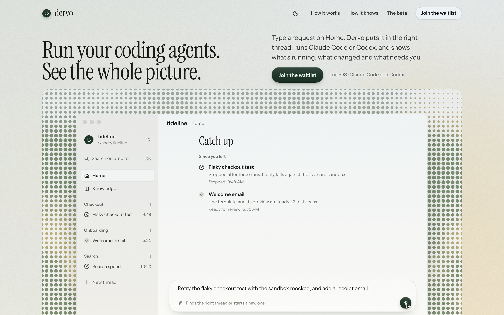

<picture>
  <source media="(prefers-color-scheme: dark)" srcset="assets/banner-dark.png">
  
</picture>

Hey, I'm Bryce. I built [Dervo](https://github.com/brambach/dervo), and it's now open for anyone to read and run.

Dervo runs Claude Code and Codex in your projects on your Mac, under your own logins. You type a request and it goes to the right thread. When you come back, Catch up tells you what needs you, what's still running and what finished or stopped. It writes that from the record of each run, not from the agent's account of itself. The code is public on [GitHub](https://github.com/brambach/dervo), source-available under FSL, and it becomes Apache 2.0 after two years. The Mac app is the most complete. Windows and Linux builds exist but are newer, and I'm not actively developing it anymore.

[Source on GitHub](https://github.com/brambach/dervo) · [trydervo.com](https://trydervo.com)

During the day I build integrations and client portals at [Digital Directions](https://digitaldirections.io). I care a lot about how software feels, and I'm just as happy down in the backend making it work.

### Other things I've made

- **[brycerambach.com](https://brycerambach.com)** ([source](https://github.com/brambach/portfolio-site)): my portfolio. You scroll down a road and a flat green 911 drives past a billboard for each project, or you [take the wheel](https://brycerambach.com/drive) of a 3D one.
- **[trace](https://github.com/brambach/trace)**: watches your local Claude Code sessions, makes every prompt searchable and shows how your prompting changes over time.
- **[port](https://github.com/brambach/port)**: an iOS ritual for putting your phone down at night.
- **[arro](https://github.com/brambach/arro)**: a private running-streak app for families.

### Find me

[brycerambach.com](https://brycerambach.com) · [X](https://x.com/brycerambach) · [LinkedIn](https://www.linkedin.com/in/bryce-rambach/)
